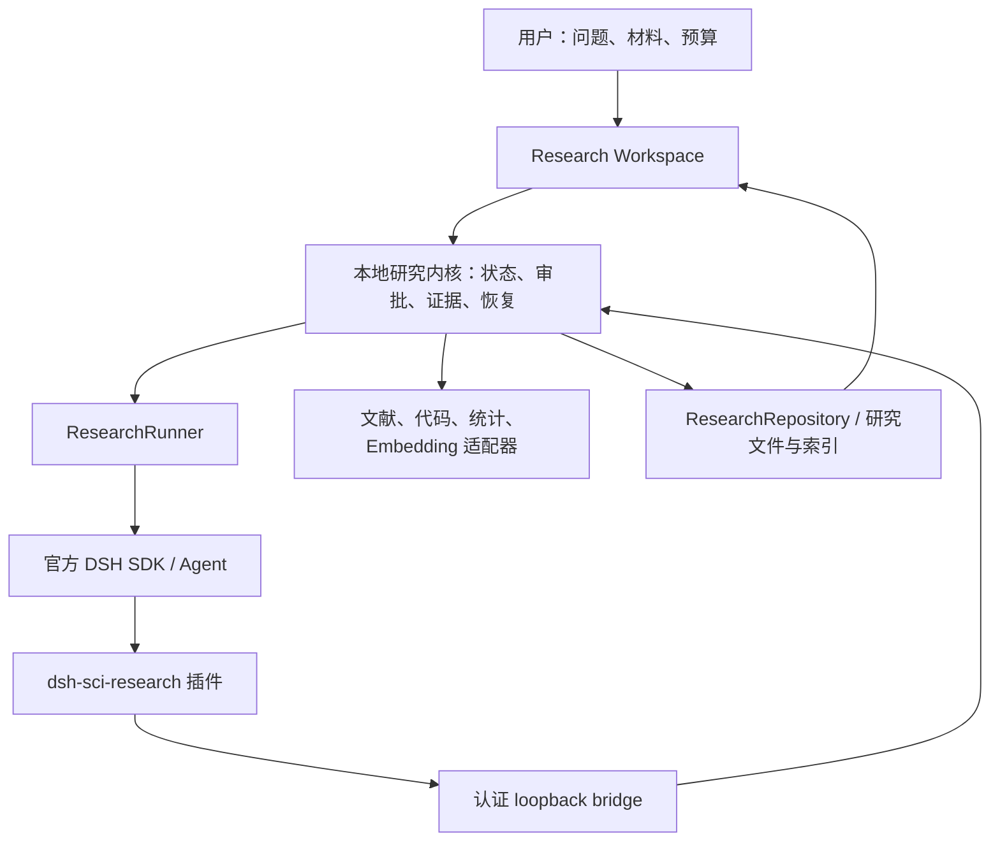

# dsh-sci 科研型 Agent 实施计划

更新日期：2026-10-30。目标是在现有 DSH/Electron 项目上完成科研 Agent MVP，安装包最后处理。下文新增字段、接口、脚本和质量阈值均是计划项，除非明确标为已有实现。

本计划已进入执行：P1.5 产品模型预算、P1.6 真实预算暂停证据和 P2 核心正文协议已有留证；P3 假设/设计协议和 W07 代码暂存/内容审批绑定已通过功能验收。后续计划中的科研质量交付仍不能计入当前完成度。本次细化以这些实际证据为起点，明确交付形式、工作包、依赖和质量门槛。

**P2 实施更新**：初稿中从 excerpt 推断已读、引用级人工支持和旧来源复用时不更新正文的问题已修正。已实现正文版本、有限分块读取、查询/获取日志与具体主张关系审阅，并取得构建、全量测试和 Electron/SDK/Harness 证据。新增真实阅读探针只验证接口链路；完整主案例与人工科研质量仍未通过。详情见 [P2 正文与证据协议](research-source-content.md)。

## 执行进度（2026-10-30 更新）

**本轮恢复与会话边界修复。** 用户批准的预算扩充已应用，但真实材料修订连续遇到一次旧 T5 类型错误、一次 provider `UND_ERR_SOCKET` 和一次错误 SDK 会话目录。新计划 `8e99e758-5cf5-43c2-905e-b62c5cce775f` 已保存，前三项严格为证据链、假设、设计；未产生新 claims/evidence/hypothesis/design，未运行实验。新增按计划持久化 DSH session 指针，保留旧项目级兼容指针；构建及 414 项回归（412 通过、2 Windows symlink 权限跳过、0 失败）通过。预算已用 29 次请求、1,340,293 tokens、4 次 unknown usage，窗口耗尽后项目保持 paused。完整复盘见 [`material-revision-summary-20261030.md`](../research/validation/material-revision-summary-20261030.md)。

**本轮增量：过期预算恢复保护。** `research-case-resume --run` 在读取 provider 配置、启动代理或 SDK 前检查持久化墙钟、请求/token 上限和 `exhausted` 标记；过期主案例只输出只读 checkpoint，不会在缺少新授权时消耗模型请求。专项测试通过，构建通过；主案例快照保持 paused，claims/evidence/实验运行数不变。证据见 [`offline-resume-guard-20261030.json`](../research/validation/offline-resume-guard-20261030.json)。

**本轮离线续跑准备。** 新增 `research:case:prepare-resume`，从权威 repository 读取主案例，校验已保存提案的前三项任务顺序、冻结协议完整绑定和 proposal/snapshot 哈希，并识别已耗尽的任务尝试。它不会调用模型、创建计划、变更审批或启动实验；默认只输出检查点，`--write` 只新增不可变的离线准备文件。主案例确认 `task-01` 已耗尽两次尝试，因此后续必须用正式新计划提交保留旧失败记录，并把提案中的文字限制规范化为结构化 `maxIterations=2`、`maxTaskAttempts=2`；不能在旧计划上直接重试。证据见 [`offline-resume-preparation-1793374255503.json`](../research/validation/cases/imputation-v1-1793358639679/offline-resume-preparation-1793374255503.json)。

**本轮已执行的离线计划提交。** 已将保存的提案通过 `research-case-commit-offline-plan` 提交为新计划 `07bb6424-8c99-487a-ae89-43138925b3f5`，旧计划 `8e99e758-5cf5-43c2-905e-b62c5cce775f` 保留为 `superseded`；项目仍为 `paused`，预算账本和旧失败尝试未被覆盖。提交动作不调用模型、不批准任务、不启动实验。下一步需要新的有效预算窗口，然后按正常 Workspace 审批和 plan-scoped session 执行前三项材料任务。

**本轮增量：长候选完整读取与主案例修订材料。** `inspect` 已支持假设/实验设计的白名单字段无损分页，SDK/插件指导 Agent 修订前读取完整旧候选；明文/加密、分页边界、只读 bridge 和项目隔离专项通过。完整回归 413 项（411 通过、2 Windows symlink 权限跳过、0 失败），构建通过；真实暂停主案例的 2 个候选、27 个字段还原一致，权威快照与前次预审相同，见[验证证据](../research/validation/candidate-detail-20261030/summary.json)。已整理[证据链与假设/设计修订草案](../research/validation/imputation-revision-draft-20261030.md)，明确主 MSE 方向、oracle 与有限样本估计器的区别、来源支持边界及跨缺失率依赖；草案属于 operator 材料，未写入正式研究记录。主案例仍因预算暂停，正式修订需正常计划/任务流程和明确预算扩充；未追加模型调用、未批准或执行完整模拟。

**最新：用户明确批准的候选行为测试已执行通过。** 用户对提案 `6279849ef81be9e548e9e7baae73e3683be6a3bc215f7e94ffd73da0a1e18b00` 回复“批准并执行该行为测试”后，经正常内核分别记录任务批准、版本批准和执行；实际 run `579d27f5-cb06-4d1a-ac7c-d0bbc8d35fb4` 为 completed、exitCode 0、184 ms，stdout/stderr 为空且未截断，7 个绑定文件执行后哈希不变。仅此测试项目已完成，完整模拟未运行；原先“0 候选执行”的记录是授权前历史状态。见[实际运行证据](../research/validation/cases/imputation-tests-1793367740427/behavior-run-20261030/summary.json)及同目录授权、运行 manifest、日志。尚未验证完整 runner 输出契约与所有 stream label，不能据此认定科研案例通过。

同时完成[主案例文献/设计开发者预审](../research/validation/source-design-audit-20261030/review.md)：3 条定位引用但无 claims/evidence/支持审阅/来源关系，现有引文不直接支持 mean/median 在目标损失下的排序；主假设预测方向和“反向”证伪条件需明确，并区分总体常数理论与观测子样本估计；跨缺失率共享数据的依赖需澄清。保存 5 条发现和 5 段逐字定位，不写入人工科研审阅、不修改原主案例、不批准正式模拟。这些是正式实验前的科研材料修订项。

**最新增量：隔离案例工作区入口。** 新增 `npm run research:case:workspace -- --case <case> [--review]`，直接打开隔离案例而不复制到主应用数据目录；默认只读，可审批模式仍不自动批准或执行。复用生产窗口/文档/权限校验，增加当前项目/计划/提案范围、主进程完整文件预览回执及已运行提案拒绝重复执行。独立任务授权、具体版本批准和执行按钮分别操作。真实待审批检查点的 Electron smoke 显示 7 个绑定文件全部渲染、3 个写接口在只读模式均拒绝，权威快照未变，0 批准、0 执行。新增 5 项回归及构建通过；全量复验 409 项（407 通过、2 Windows symlink 权限跳过、0 失败），初次全量的 Windows 内存探测瞬时失败及独立复验日志保留。实际入口首次因 Electron argv 位置差异失败，修正后可审批窗口启动成功；未在真实检查点点击批准/执行。使用方式与限制见[隔离案例工作区](research-case-workspace.md)。该入口不替代来源/设计质量审阅、候选行为测试或完整主案例验收。

**最新增量：局部修订、零种子算法版本与可审批测试提案。** `code-stage {baseBundleId,files}` 对本任务/当前计划祖先 bundle 的全部文件重新核对，未变文件按字节继承，完整合并仍受数量/字节限制，审批和读取回执不继承。新增跨项目/旧计划/无关任务、合并限额、重名和审批隔离检查。统计内核默认 `bootstrap.v2` 修正 seed=0，保留显式 v1 历史重放，并把新评估输入/结果版本锁定；旧记录不改写。构建、404 项全量回归（402 通过、2 Windows symlink 权限跳过、0 失败）、官方 SDK 引用纠正和 56 文件 package smoke 通过。

真实局部修订链路已跑通，但模型仍漏检浮点夹具和抽样索引错误。Operator 明确修正夹具、有效重复数报告与运行前源文件漂移核对，完整数值实现与冻结协议保留；人工干预不算自主修复。最新真实静态审查读取 7 个文件、记录 1 份审查，未报告 blocker，仍明确保留行为测试及完整 runner 输出未验证、设计未绑定等限制。新建 `imputation-tests-1793367740427` 测试检查点，具体命令、完整代码/输入与提案哈希均已绑定；任务 `waiting-approval`、无批准、0 次执行。该提案只运行行为测试，不能替代主案例模拟、文献/设计审阅或科研验收。详见[本轮汇总](../research/validation/focused-revision-20261030/summary.json)及[测试审阅包](../research/validation/cases/imputation-tests-1793367740427/review-packet-1793367771971/review.md)。完整目标、W08—W14 和安装发布验收保持未完成。

**上一轮：结果引用纠正与候选协议恢复。** SDK 在提交前使用与内核相同的项目记录清单核查 refs，错误 ID 由模型在同一 attempt 内纠正一次；身份/引用共用持久化次数上限，断连或新 Executor 不重置。跨项目记忆不进入反馈，未知文本不回显，产物和审批门槛仍由内核重新检查。构建、397 项全量回归（395 通过、0 失败、2 个 Windows symlink 权限场景跳过）、9 项新增纠正专项、官方 SDK 引用/身份纠正计量及 56 文件 package smoke 通过。真实候选/审查验证仍不能算科研闭环通过。

上一轮 `code-revision-live-1793363803047` 实际失败：8 次请求、264,805 已报告 token，保存 2 个 bundle、12 次读取和 1 次审查，最终因 refs 中错误 bundle ID 被内核拒绝，没有触发身份修复。新引用纠正后 `code-revision-live-1793364386478` 保存完整冻结协议及两个候选（第一个语法错误，第二个解析通过），但 360 秒任务截止前没有提交有效结果，4 次请求、81,442 已报告 token、0 审查，失败保留。Operator 明确选择第二个已保存候选导入独立静态审查，没有复制任务完成/审批，没有改写原主案例或执行代码。新候选完整协议哈希已与基准核对一致；零种子测试期望仍有误，非退化 bootstrap 和阈值测试仍缺失。完整主案例和 W08—W14 保持未完成。

独立静态审查 `code-review-live-1793364876457` 已完成：4 次真实请求、76,535 已报告 token，6 个文件完整读取、1 份审查记录、0 次实验，原案例未变；没有触发引用或身份纠正，因此不把这次成功当作真实纠错验收。Agent 仍漏检了 RNG 测试错误：独立 Python 整数运算给出零种子首值 `0.26642920868471265`，十二位小数应为 `0.266429208685`，候选断言却写成 `0.266429208682`。只执行了独立标量运算，没有导入候选或运行其测试。完整证据及剩余工作见[本轮汇总](../research/validation/result-reference-20261030/summary.json)。

**最新推进：候选修订、长审查详情和静态语法守卫。** `code-stage` 现在保存 JavaScript 静态解析诊断；坏语法候选保留，但准备任务完成前必须修订并重新解析。解析不导入/执行候选，也不证明行为测试或数值正确。`inspect` 新增 findings/limitations 的完整分页读取，避免长审查记录被 inventory 整条省略。SDK 对 schema 合法但身份错误的结果增加同一 attempt 内最多一次模型修复，保持身份、预算和产物门槛；暂停或已变化任务不能修复。具体接口与边界见[代码审查与修订协议](research-code-review.md)。

真实模型 `code-revision-live-1793361913401` 用 9 次请求、229,159 已报告 token 完成“读取导入 → 模型暂存新候选 → 后续任务完整读取并审查”，保存 3 个 bundle（含导入及中间版本）、10 次读取和 1 次审查。它仍发现协议/行校验、模块哈希和行为测试缺口；不是候选通过。第二次 `code-revision-live-1793362637516` 用 4 次请求保存 2 个修订 bundle，但最终结果身份错误，0 审查；原失败保留，不修改状态冒充成功。原主案例未改写，所有探针均 0 实验。身份修复后的真实复验另行留证，不能用合成 smoke 替代。

最终完整回归 388 项（386 通过、2 个 Windows 符号链接权限场景跳过）、成功构建、实际 Electron、SDK 普通/身份修复、Harness 和 55 文件 package smoke 通过。一次全量中的网络超时测试提前发生连接错误，单独复验与完整重跑均通过，失败日志保留；未重跑完整 release preflight、崩溃或 Linux/安装版验收。详见[本轮验证汇总](../research/validation/code-revision-20261030/summary.json)。

**上一轮：增加专用静态代码审查任务，完整科研流程仍未验收。** 默认计划现在为 9 步，在准备代码后、实验前加入 `code-review`。Agent 通过有界 `code-read` 读取已注册代码、输入和依赖，回执绑定文件哈希及本次 attempt；必须完整读取后才能保存静态检查。检查绑定 bundle/设计版本，变更或重试后旧回执不能充当新任务完成凭据。Workspace 显示发现与限制，保持 `not-reviewed`，不提供检查记录内的批准按钮。

真实模型专项 `code-review-live-1793360617700` 用 4 次请求、70,821 已报告 token 完成 3 份代码读取回执与 1 份静态检查，发现缺测试源码、环境字段和 seed 冲突检测等问题；0 次实验、旧主案例未修改。模型也漏掉 master 类型和 masks 键等问题，并提出 manifest 自身哈希、外部设计 ID 等待复核建议，因此仅证明读取—记录链路，不能宣称代码正确或审查质量通过。Electron smoke 验证检查展示、文本转义及无状态变更。最终自动化验证与已知限制见[静态审查验证汇总](../research/validation/code-review-20261030/summary.json)。

**上一轮：阅读恢复通过真实专项验证。** SDK 重试上下文现在提供已保存引用的精确版本和 chunk 读取请求，不注入正文冒充阅读；同时提供本任务代码包清单。`reading-retry-live-1793359664672` 用 13 次真实模型请求完成“保存引用 → 开发者注入中断 → 新尝试重新读取 → 复用原 citation ID 提交”，只有 1 条引用、0 次实验；中断是测试注入，不能宣称自然超时或科研质量验收。此前一次探针因步数上限未触发注入，另一次在重新读取后耗尽 12 次请求，均保留为失败证据。新成功探针使用独立 16 次请求配置，没有扩充旧项目预算。

新主案例 `imputation-v1-1793358639679` 重放已有模型计划，完成 T1—T4 的结构契约，保存 3 条引用、1 个假设、1 个设计和 2 个代码候选版本，T4 只引用第二个版本。T5 因模型 token 预算暂停，22 次请求及 1,043,256 已报告 token 与独立代理核对一致；0 次实验。静态核查发现配置类型、掩码输出键、seed 冲突检测、环境输出和测试源码缺口；不能把 T4 完成算作完整代码验收。此外发现重放脚本丢失自定义成功标准，现已修复并加入保留全部标准、清空旧状态/审批、20 条自定义标准往返和内核标准去重回归。旧案例事实不改写，修复后的完整主案例尚待复验。

最新构建、373 项全量回归（372 通过、1 项 Windows 符号链接权限跳过）、SDK 和 53 文件 package smoke 通过。本轮没有重跑 Electron/Harness/崩溃 smoke 或 release preflight。下一步先修正候选代码及静态审查任务分类，补实测环境，再交 Workspace 明确审阅；不自动批准或执行。详见[最新验证汇总](../research/validation/reading-recovery-20261030/summary.json)和[候选静态问题](../research/validation/reading-recovery-20261030/candidate-static-review.md)。

**上一轮记录**：已核实 `PMC3668100` 的出版社可访问版本，并以显式补充线索保存来源，不覆盖旧案例或改动冻结协议。重放案例 `imputation-v1-1793355640516` 完成 T1—T4（3 来源、3 定位引文、1 假设、1 草稿设计），T5 正确因旧 custom 权限缺少 code-stage 阻塞。修复后 `imputation-v1-1793356293946` 仍在 T5 两次超时失败，0 代码包；最后新规划 `imputation-v1-1793357676440` 已实际使用 code-preparation 类型，但文献任务第一次超时，第二次复用旧轮次引用且未重新读取，完成门槛拒绝，0 任务完成。均没有批准或运行实验。当时新增当前尝试阅读重试指引，40 项相关回归及 SDK smoke 通过，尚无该指引后的完整主案例复验。

独立真实模型 `code-live-1793357477232` 探针用 2 次请求成功暂存 1,427 字节完整随机化候选模块并通过任务结构契约，0 次执行。新增只读人工审阅包，能重算定位文本、展示阅读回执和候选材料；不会写科研报告或批准。该局部成功不替代完整案例。最新构建成功，完整回归 371 项（370 通过、1 Windows 权限跳过），SDK/package smoke 通过。独立来源支持性、反证、假设/设计质量和完整科研闭环均待验。详见[本轮证据](../research/validation/research-code-preparation-20261030/summary.json)。

| 阶段 | 当前状态 | 已取得的证据 / 剩余工作 |
| --- | --- | --- |
| P0 | 已取得真实基线 | 冻结 `imputation-v1`；两次真实 SDK 运行均失败，保存原因与轨迹；不代表科研案例通过 |
| P1 | 进行中 | 共享结果协议、结构完成门槛、任务动作范围、持久化任务/时间预算、可信工作区配置、计划/执行身份绑定及提交日志恢复已实现；产品级模型调用预算已实现并通过自动化回归；真实预算暂停与计量已核对；完整科研质量未通过 |
| P2 | 核心实现通过回归，W05 功能部分实现，科研质量待审 | 已接版本化正文、有限读取、检索/获取日志、定位引文与主张级人工审阅；来源关系/独立性标记已进入内核和 Workspace，反证关系可用。真实 SDK 阅读探针通过接口检查；3 个独立来源、反证材料和主案例人工核查待补 |
| P3 | 假设/设计/代码绑定功能验收通过，科研质量待审 | 已加入结构化假设、哈希绑定设计、设计审批和修订失效；代码暂存、文件 manifest、提案哈希、可信内容预览/审批及启动前核对已实现。W06/W07 专项、212 项完整回归（211 通过、1 项 Windows 符号链接权限跳过）、Workspace/SDK/Harness/package smoke 通过；真实主案例与独立复现待验 |
| P4—P6 | 待推进质量和环境验收 | 可复用已有评估、报告、记忆及恢复模块；按下文逐项补齐，不能仅按模块是否存在判定完成 |

**2026-10-30 执行更新**：开始按主案例推进后发现历史 T4 候选代码把冻结的固定数量 Fisher–Yates 遮蔽实现成了 Bernoulli 遮蔽，并把实用相对差异分母写成中位数损失。该候选设计和代码包保留为审计证据，未批准、未执行；`research-case-protocol.mjs` 现在把完整冻结协议和哈希注入规划/执行上下文，恢复命令拒绝未绑定协议的历史案例，独立 replay 要求固定数量遮蔽、完整 100/8 条件矩阵及均值损失分母。两次新的真实规划尝试均因上游 120 秒超时暂停，未产生实验结果。协议传递、Python 独立参考回归和“已批准 design/code/run/artifact 才能 replay”的 provenance 绑定已加入；全量测试为 228 项，227 通过、1 项 Windows 符号链接权限跳过。

P1.5 历史自动化回归见 [模型预算验证](../research/validation/research-model-budget-1793300491685.json)：构建成功，166 项测试（165 通过、1 项 Windows 符号链接权限跳过），Harness/SDK/真实 Electron Workspace/完整应用崩溃/34 文件 package 五类 smoke、案例协议检查、语法和 diff 检查通过。官方 SDK 的 2 次上游尝试与 2 份产品预算预留一致；新增 15 项模型预算行为回归。前轮 [结果身份与恢复验证](../research/validation/research-result-protocol-1793298974897.json) 保留为历史证据。本轮未重跑完整 release preflight，真实科研复验另行留证，未生成安装包。

真实基线详见 [基准案例与结果](research-agent-benchmark.md)：首次产生 12 步模型计划，17 次上游请求后卡在结果 schema，0 任务完成；第二次原样重放该模型计划，完成 5 任务后耗尽 32 次请求。第二次仅说明当时的 schema 修复有进展，之后新增的完成门槛和预算尚无真实案例验收。两次均未运行实验、统计评估、报告和记忆；通用搜索未配置，引用尚未核查通过。

最新 [P1.6 真实复验](../research/validation/cases/imputation-v1-1793300481509/summary.json) 重新由模型规划 10 步，完成 T1—T3 后因已报告 token 阈值暂停；23 次实际请求、1,053,593 已报告 token、1 次 unknown，产品与独立代理逐项一致。[计量核对](../research/validation/cases/imputation-v1-1793300481509/budget-reconciliation.json) 也验证重建 Repository 后不能直接恢复。新 resourceConfiguration v2 增加 token 阈值，不与旧运行作同资源性能比较。3 条引用均有定位但仍无法在保存摘录中核验，无实验/评估/报告/记忆，scientificQuality 保持 not-reviewed。随后已完成 W04 的核心实现，下一步补 W05 的独立来源/反证与人工质量核查，并继续 P3 假设与设计。

P2 当前验证见 [正文与证据验证](../research/validation/source-content-1793302618754/summary.json)：构建成功，179 项测试（178 通过、1 项 Windows 符号链接权限跳过），新增 13 项来源/阅读/审阅行为测试；实际 Electron、SDK、Harness、40 文件 package smoke 通过。没有运行完整 release preflight，也未生成安装包。

[P2 真实阅读探针](../research/validation/source-live-1793302351900/summary.json) 使用一项开发者提供的阅读任务，真实模型调用 11 次、156,171 已报告 token，完成 Crossref 学术元数据检索、保存 3 个正文/摘要版本和 3 份阅读回执，生成 1 条可定位逐字引文及对应主张/证据关系。独立发现的论文只读摘要；两个人工提供的网页仅部分阅读。无人工支持审阅，scientificQuality=not-reviewed。该探针不替代冻结主案例，不能与 P1.6 作同任务/资源性能比较；其代码哈希保留在原目录，之后的来源刷新记账及结果提交推导补强由本轮自动化回归覆盖。

## 1. 产品目标与交付形式

用户输入研究问题并提供研究范围或材料后，系统能持续完成：任务拆解和计划 → 检索与阅读 → 提出假设 → 实验设计与审批 → 代码/数据工具执行 → 评估与迭代 → 带证据链的报告 → 跨会话研究记忆。

MVP 首先面向文献研究和本地计算实验。湿实验、机器人实验、无人值守操作任意外部系统、多人云协作不进入本轮范围。“自主”指在授权和预算范围内推进；实验审批、关键设计变更和证据冲突会使系统暂停等待审阅。

交付采用 **一个 DSH 插件 + 本地研究内核 + Research Workspace**。Rewind 作为能力与交互参考，不宣称已复现其全部功能，也不将调研样本源码直接用于产品。



| 层 | 现有落点 | 职责与边界 |
| --- | --- | --- |
| DSH 插件 | `desktop/dsh-sci-research-plugin.mjs` | 生命周期、上下文、三个研究工具；可写自身插件事件和状态标记，不直接修改权威研究记录或批准实验 |
| Agent 接入 | `src/research/dsh-sdk.ts` | SDK 驱动、会话恢复和输出解析；模型提交候选结果，内核判断能否接受 |
| 研究内核 | `src/research/orchestrator.ts`、`runner.ts`、`planner.ts` | 状态机、任务、审批、调度、预算和迭代 |
| 工具桥 | `src/research/bridge.ts` | token、Origin、schema、项目/任务范围和审计 |
| 持久化 | `src/research/repository.ts` | 权威研究记录、加密、索引、事件、恢复及后续迁移 |
| 人工工作区 | `desktop/research-dashboard.mjs`、`research-preload.cjs`、`main.mjs` | 计划、审批、证据浏览、评估、记忆审阅、报告导出 |

保留插件工具 `research_context`、`research_record_event`、`research_action`。新能力优先扩展内核 adapter 和版本化 action schema，不为七项能力分别搭建互不关联的 Agent 框架。插件脱离本地内核时应明确报告不可用。

**插件交付边界**：本轮首先交付在 dsh-sci 内运行的科研插件，沿用官方 DSH 的插件/profile 接口，固定当前验证版本 `@deepseek-ai/dsh@0.2.1-rc.2`。插件注册、工具 guard 和 SDK 行为在依赖升级时重新验证。把插件复制进任意 DSH 即可使用，不是当前承诺：它还需要研究内核、认证 bridge、持久化目录、provider 配置及工作区。后续如需独立分发，再提供内核服务启动器和兼容性清单。

先维持单个研究 Runner 顺序调度任务，不引入多 Agent 并行研究。搜索、阅读、实验、评估和记忆以 adapter/action 扩展，避免先增加调度复杂度。底层模型可替换；研究状态和证据记录由内核维护。

此前的 [Rewind 本地逆向记录](../research/rewind-analysis-report.md) 仍在仓库。该记录支持 Electron/DSH 插件、捕获、服务适配和恢复等架构参考；其“当前差异”是调研时的历史状态，不作为今天的缺口清单，也不能据此确认 Rewind 服务端的科研能力。

自动研究模式已有工具 guard/restrict，只暴露研究工具；普通 DSH 聊天模式单独管理权限。仍需真实 Harness 验证各工具传输路径不能绕过限制。命令白名单、路径校验和进程监督不等同操作系统沙箱：允许 Python/Node 执行代码并不能自动阻止其访问网络或其他文件。

### 七项需求对应的最终产物

| 用户需求 | Agent 的具体行为 | 可持久保存、可验收的产物 | 主阶段 |
| --- | --- | --- | --- |
| 自主拆解和计划 | 把自然语言问题拆成有依赖、完成标准和预算的任务，发现缺输入时询问或阻塞 | 项目、版本化计划、任务状态、阻塞/停止原因 | P1 |
| 检索、阅读和引用 | 记录查询，筛选独立来源，区分摘要和正文，将主张定位到原文 | 查询日志、来源、正文 chunk、定位、引文及审阅结果 | P2 |
| 形成假设和设计实验 | 给出可观测预测、反驳条件、对照、分析单位和预先规定的指标 | 独立假设、实验设计及其版本 | P3 |
| 调用代码、数据和工具 | 准备代码，在批准的具体代码和输入上执行，保存环境与产物 | 审批记录、manifest、run、日志、指标和产物 | P3 |
| 评估并迭代 | 检查统计方法适用性，计算效应和不确定性，决定修订或停止 | 评估记录、依据、停止理由、新计划/设计 | P4 |
| 生成证据报告 | 将结论链接到引文或运行指标，列出反证、限制和未解决问题 | 草稿、质量检查、人工审阅状态、MD/HTML/JSON | P5 |
| 跨会话语义记忆 | 保存带范围和来源的研究知识，在后续会话检索并提示冲突/过期 | 记忆条目、embedding/索引版本、检索与注入记录 | P5 |

以上七项共用一套项目与证据模型。后台 capture 用于观察和恢复；不能单凭会话日志、文件快照或模型自述把产物判为科研结论。

## 2. 当前基线与缺口

| 能力 | 已有实现 | 本轮需要补齐 |
| --- | --- | --- |
| 自主计划 | 默认/模型规划、依赖校验、Runner、重试/取消/步数限制、SDK 会话恢复 | 按任务类型验证完成条件、项目预算、真实研究质量 |
| 文献与证据 | 搜索、DOI/Crossref、arXiv、网页、本地文档、PDF chunk、可选 OCR、引用/主张/证据链 | 正文支持关系审阅、搜索覆盖、人工引用/OCR 抽样 |
| 假设与设计 | 独立假设、可证伪字段、变量/对照/分析方案、设计版本、哈希审批和修订失效 | 真实主案例中的假设/设计质量、分析单位及停止规则核查 |
| 实验与产物 | 审批、manifest/哈希、环境过滤、配额、取消/超时、运行 journal、监督进程；受控代码暂存和内容绑定审批已进入代码 | 新内容审批边界专项与 Workspace 验收、环境重建、独立复现、发布环境复验 |
| 评估与迭代 | 阈值/统计 evaluator、评估记录、迭代上限、计划版本、冲突审阅门槛 | 方法适用性、实际效应、不确定性、停止理由 |
| 报告 | Markdown/JSON/HTML、证据图、限制与警告、已有报告只读导出 | 草稿/审阅完成状态、断链/引用检查、人工质量门槛 |
| 跨会话记忆 | 词法+哈希向量、可选 embedding、去重/冲突审阅、可信度/时间过滤 | 中文改写召回、索引版本/重建、自动检索注入及适用范围 |
| 权限与工作区 | 项目/任务审批队列、记忆批量审阅、可信窗口 IPC、项目动作审计 | 内核只读权限、无项目/未认证请求审计、证据浏览体验 |
| 可靠性 | SDK 重建、完整 Electron 开发版崩溃恢复、interrupted、禁止直接重跑 | 升级兼容、系统网络故障、Linux 实机和断电语义 |

已保存的最近完整预检是 [release-preflight-1793295006418.json](../research/validation/release-preflight-1793295006418.json)，时间 **2026-10-29T17:31:29.764Z**，即北京时间 2026-10-30 01:31:29。其构建、116 项测试（115 通过、1 项 Windows Developer Mode 跳过）、Harness/SDK/Workspace/完整应用崩溃/package 五类 smoke、恢复审计、语法和 diff 检查通过。该报告是后续协议/预算改动前的历史基线；最新局部验证见上方执行进度，不将旧预检冒充当前完整预检。

真实 provider 20 步验证属于合成可靠性任务；Windows 完整应用崩溃验证针对开发版。二者不证明科研结论质量、Linux 或安装版升级通过。详细证据见 [research-agent-validation.md](research-agent-validation.md)。已有安装包不代表当前工作树，不删除、不重新生成。

## 3. 用户最终如何使用

1. 创建研究：输入问题、目标、材料、约束和预算，选择文献研究或计算实验。
2. 确认计划：检查任务依赖、预期产物、完成标准和审批步骤，编辑后启动。
3. 自动研究：检索、阅读、记录引用、提出假设和实验设计；显示当前步骤、预算和阻塞原因。
4. 审批实验：查看设计、命令、代码差异、输入输出、依赖和权限；批准绑定具体提案版本。
5. 执行与评估：运行代码、登记产物、计算指标，解释支持/反驳/不确定的依据。
6. 迭代或停止：生成带变更摘要的新计划；变化的实验重新审批。
7. 审阅报告：从结论追到原文或运行；存在未解决问题时保留草稿和警告。
8. 继续旧研究：新会话检索记忆，保留来源、适用条件、置信度和冲突提示。

## 4. 分阶段实施工作包

按一名主要开发者、模型/检索服务正常、Windows 开发环境估算，**从当前状态到 Windows 预览验收约剩 15—24 个净工作日**，包含 P1 收尾、P2—P6 和完整案例复验，不把已完成工作再算一次。这个估算是排期依据，不是交付承诺；失败修复、人工审阅、外部服务及 Linux 环境等待会延长日历时间。安装与发布另外安排。

### P0：冻结真实案例与验收协议（1 天，首先执行）

**目的**：先测现有系统能推进到哪里，再根据实际失败点开发。

- 主案例：研究“在预先定义的缺失机制与缺失率下，均值插补和中位数插补对有偏分布数据的恢复误差有何差异”。文献真实可检索，数据固定种子生成，结论限定于设计中的分布和机制。
- 增加阴性/不确定案例：对称分布或样本不足，检查系统能报告无明显差异或证据不足。
- 人工先冻结问题、数据规则、主指标、对照、重复次数、分析单位和预算；看过结果后改指标必须留记录。
- 用现有真实 SDK 跑基线，保存人工接管点、失败原因和实际轨迹。失败也是证据，不手工补假记录使流程看起来通过。
- 外部模型/搜索调用记录用量与可获得的成本；服务不可用则 blocked，不用 stub 冒充真实科研验收。

**交付**：新增 `docs/research-agent-benchmark.md`；脱敏材料和轨迹位于 `research/validation/cases/<case-id>/`；后续可新增 `scripts/research-case-smoke.mjs`，真实调用作为显式运行选项。

**退出条件**：输入、预定指标、人工操作、失败点和证据位置清晰，形成实际修复清单。P0 不要求尚未实现的能力一次通过。

### P1：研究协议、完成条件和预算（2—3 天）

**修改位置**：`domain.ts`、`planner.ts`、`task-result.ts`、`runner.ts`、`orchestrator.ts`、`repository.ts`、`bridge.ts`、`dsh-sdk.ts`。

- 任务增加版本化 `successCriteria`、必需输入/输出类型、`allowedActions`、结构化阻塞原因。schema 由内核维护，模型不能任意提交 schema 放宽要求。
- 按类型校验完成：阅读需正文或明确仅摘要；假设需可证伪字段；实验需真实 run；评估需可复算指标；报告需质量检查。
- 结果绑定 planId、提交 ID 和预期状态版本；定义重复提交/崩溃重试的幂等语义，拒绝跨计划结果。
- 汇总步数、模型请求数、总时长、重试与迭代预算。能获得 usage 时记录 token/成本，缺失则 unknown，使用调用数/时间等已知上限，不声称精确 token 封顶。
- 预算耗尽保存检查点并暂停，不算研究完成；恢复后预算不重置，增加预算需显式操作。
- 定义 v1 兼容读和迁移。旧任务缺新字段时标记待补，不静默认定满足新标准。

**交付**：版本化协议、类型验证器、预算记录、旧格式 fixture、重复提交/重试回归。

**退出条件**：缺必需产物不能完成任务；旧计划/重复提交不产生重复记录；预算重启仍有效；失败重试不重复写入已确认引用和实验。

**P1 当前拆分与下一步顺序**：

| 子工作包 | 状态 | 具体交付与验收 |
| --- | --- | --- |
| P1.1 结果协议 | 已实现，自动化回归通过 | SDK/bridge 共用 schema；已有 ID 放 refs，新 claims/evidence 才提交对象；错误反馈进入下一次尝试 |
| P1.2 完成契约 | 结构部分已实现 | research/source-review 要求来源和引用；hypothesis 要求当前任务假设主张；design 要求当前计划/任务提案；experiment 要求已完成 run；evaluate 要求当前任务评估；report 要求本任务开始后报告。正文支持性、可证伪性及报告质量仍由 P2/P3/P5 补齐 |
| P1.3 任务/时间预算 | 已实现，自动化回归通过 | 默认 100 次、首次执行起 1 小时；重试计次，暂停/退出计时；审批等待不计次且未执行前不启动时钟；重启/replan 不重置。耗尽先暂停，Workspace 明确修改再单独恢复；模型无扩充接口 |
| P1.4 结果身份与收据 | 已实现，自动化回归通过，真实提交已核对 | v2 结果携带 planId、attemptId、submissionId、expectedTaskVersion；不自动补旧结果身份。同 ID 内容不同拒绝，相同已接受提交只读返回原收据。prepared/committed 日志恢复主张、证据、状态、事件和上下文；七处写入故障及明文/加密子进程退出已验。旧执行器结果/异常不误改新计划，详见 [协议与边界](research-result-protocol.md) |
| P1.5 模型调用预算 | 已实现，自动化与真实计量核对通过 | 内核统一接入规划与 SDK 上游传输；每次真正网络尝试前持久化预留，SDK/provider 重试同样计次。usage 可获得时汇总 token，否则 unknown；不能用任务次数或 Harness 步数冒充实际请求数。扩充仍仅可信工作区授权 |
| P1.6 真实复验 | 已保存真实预算暂停结果，进入 P2 | 使用同一冻结协议，新目录保留运行代码哈希、停止原因和人工动作；先验证契约/预算再进入 P2。案例仍可以因来源或审批阻塞，但不得虚报完成 |

旧计划保持只读兼容并标记需要协议复核；工作区提供“重新规划”。旧项目缺 budget 时自动执行返回具体阻塞原因，必须人工明确设置，不在重启时赠送新额度。当前预算保存为独立项目记录并随项目导出，校验 schema、项目归属、版本、计数和时间；预算损坏不能静默重置。

结果日志提供单个桌面写入者下的进程崩溃恢复，不宣称多文件快照隔离或已验证断电落盘。通过其他工具提前保存的记录不属于结果日志事务，其调用去重和权限仍需各自验收；不能据此宣布 P1 全部退出条件通过。

#### P1.5 实施顺序：统一规划与 SDK 的模型预算

以下列出原断点和已实施方案：`createProject` 已改为先保存项目/预算再规划；规划器带预留/结算回调；SDK 通过产品模型代理连接 provider。详情见 [项目模型预算与计量](research-model-budget.md)。下表作为实施与验收明细保留，真实案例接线已由 P1.6 独立验证预算停止与计量。

| 顺序 | 工作项与修改位置 | 验收条件 |
| --- | --- | --- |
| B1 | `budget.ts` / `repository.ts`：定义 budget v2、模型请求预留和结算记录 | 旧计数保留；v1 缺模型额度需明确配置；损坏记录阻塞，不自动补额度 |
| B2 | 内核增加 `reserveModelRequest` / `recordModelUsage`；持久化后才允许网络尝试 | 最后一个名额被并发请求竞争时最多一份预留成功；结算重复到达不重复累计 |
| B3 | `provider.ts` / `planner.ts` / `orchestrator.ts`：预算先于模型规划建立，规划和 replan 接计量 | 首次规划计费；replan 不清计数；额度耗尽返回明确阻塞，不被默认计划 fallback 掩盖 |
| B4 | 新增 `src/research/model-budget-proxy.ts`，接入 `dsh-sdk.ts` | SDK 的普通/流式请求、模型内部重试均经同一项目预算；重建 SDK 不重置 |
| B5 | `desktop/main.mjs` / 工作区：显示并修改模型额度，保留现有可信窗口校验 | 展示请求、已报告 token、未知 usage 和暂停原因；模型/bridge 不可增加额度 |
| B6 | 扩展 provider、科研和 SDK smoke 的行为回归，记录脱敏验证结果 | JSON/SSE、超时、断连、重试、并发、重启、未知 usage 和密钥边界均有证据 |

建议预算字段为 `maxModelRequests`、`maxModelTokens`、`usedModelRequests`、`reportedInputTokens`、`reportedOutputTokens`、`reportedTotalTokens`、`unknownUsageRequests`，另保存不可变 `reservationId`、阶段、状态和结算信息。所有计数采用安全整数并校验项目归属；规划、replan、任务调用进入同一项目账本。既有任务/时间限额、首次执行时间和耗尽状态迁移后保留。

计数和恢复语义先固定，再实现传输：

1. 每次网络尝试前，原子保存预留及相应计数；网络请求与文件落盘无法构成同一事务，所以计数代表已预留尝试的保守上界。落盘后崩溃、取消或无法确认是否发出，不自动退还请求额度。普通重试使用新预留，不能复用旧 ID 发第二次请求。
2. 已结算 reservation 重复结算相同内容返回原记录，内容不同拒绝。预留、汇总计数和结算状态使用同一原子预算记录，或提供独立可恢复 journal；不能依赖两个普通文件“先写一个再写另一个”而宣称崩溃时恰好计数一次。
3. 重启后未结算请求标记 usage unknown，保留已用额度；不为恢复记账重新调用 provider。相同结算不能重复增加 unknown 数。未知 token 不当作零成本或精确已知用量。
4. token 限额是基于 provider 已报告用量的停止阈值，单响应输出另有限额。缺少 usage、在途请求和输入 token 不可精确预估时，不能承诺绝对 token/费用硬封顶。total-only usage 也要保留；缓存 token 等明细只在 provider 明确返回时展示，不重复相加。
5. 请求预留不能使最后一个获准请求尚未返回就被自身额度检查取消；最后一次响应仍可结算和提交合法结果，下一次模型调用才拒绝。达到停止条件保存状态并暂停，增加额度与恢复是两个独立操作。
6. 规划调用不持有等待预算预留所需的同一项目锁，避免 replan → planner → reserve 嵌套死锁。使用短事务处理预留/结算，网络等待在锁外；replan 提交前复核计划版本，拒绝过期规划覆盖。

规划失败后的项目必须可查看：先持久化初始项目与预算，保存 planning/blocked 原因；没有计划的项目不伪造已生成计划，工作区可修改额度后显式重试。provider 不可用或模型输出无效的 fallback 单独记录规划来源与错误类别，不能把本地模板显示为模型自主规划。预算耗尽、用户取消和持久化损坏不进入静默 fallback。

SDK 代理只绑定随机 loopback 端口和路径，使用随机短期 token，拒绝 Origin、错误认证、非约定方法及路径；上游地址由可信配置固定，不能被请求指定。SDK profile 指向代理，子进程环境过滤继承的 provider 密钥，只注入代理 token；真实密钥留在父进程。转发使用明确允许的 headers，不转发客户端认证或任意凭据。日志仅留 reservation、阶段、状态码、耗时和 usage，不留正文、响应内容或密钥。JSON/SSE usage 增量解析须有大小限制，取消与关闭要释放上游请求和连接。

模型预算首先覆盖项目规划与 SDK 的 Responses 调用。搜索、OCR、embedding 各有服务开销，后续应显示独立计量/限制；未接入时明确标为未计量，不能把模型预算称为整个研究的精确费用上限。

#### P1.6 真实复验与进入后续阶段的条件

- 先核对 v2 身份的真实提交入口：当前 `parseResearchTaskResult` 要求完整身份并拒绝显式 v1，不能为兼容旧 fixture 回填当前身份。补充 bridge/SDK 实际入口检查，文档和行为一致后再跑案例。
- 使用冻结的 `imputation-v1`、新运行目录和新代码哈希，接入产品预算。案例代理可保留作独立观测，但必须区分代理次数和产品计数；保守预留造成差值时说明原因。
- 首先只验证 P1 的任务契约、预算、暂停与恢复；遇到正文能力、代码准备或审批缺口就保存阻塞并转入相应阶段修复，不手工补写结果。重放旧计划与重新模型规划分别标注。
- 原 32 次请求不足以跑完整案例时保留失败，新增资源配置版本并记录调整理由；问题、数据和主指标仍冻结。预算变化不能被描述为同额度性能提升。
- 退出 P1 需要真实调用证明接线有效，但不要求此时 P2—P5 的科研质量全部通过；完整闭环仍留到最终验收。

### P2：检索、阅读和引用质量（2—3 天）

**修改位置**：`source-adapters.ts`、`document.ts`、`ocr.ts`、`evidence.ts`、`orchestrator.ts`、`report.ts`、`src/services.ts`。

- 记录查询、provider、时间、翻页、去重、筛选理由和失败；区分发现来源、只读摘要、已读正文。
- 保存可合法存储的内容快照或摘录、哈希、版本和访问状态；失效链接/付费墙明确提示，搜索摘要不冒充全文。
- 主张链接 chunk/页码/段落和短摘录，分别检查引用存在、定位、摘录相符、是否支持主张；模型支持性判断保留人工待审状态。
- 收集正反证据；建立预印本/正式版与重复来源关系，避免重复计票。
- 文献内容视为不可信输入，验证其中指令不能改变审批、预算或工具权限。
- 用真实扫描 PDF 核对页码、OCR provider、失败和低置信度警告，不凭空设统一可信阈值。

**交付**：检索日志、来源阅读状态、引用检查结果、PDF/OCR 样本与人工核对表。

**退出条件**：主案例至少 3 个独立相关来源。主张不足 10 条时全部复核，否则至少抽样 10 条；样本定位全部有效，明显不支持或相反的引用在定稿前修正。报告事实性结论均有证据链接；无法核查的内容保留为限制或假设。

#### P2 工程拆分与先后顺序

下列名称为拟定接口/记录，实施前检查现有 schema，确定版本与兼容行为。每项先完成内核和持久化，再接 bridge/Workspace；不能由模型写入可信审阅字段。

| 顺序 | 工作与文件 | 必交产物 | 验证方式 |
| --- | --- | --- | --- |
| P2.0 | 修正 `evidence.ts` / `orchestrator.ts` / `task-contract.ts` 初稿 | 旧来源默认 discovered；候选 excerpt 不推断已读；引文存在性与主张支持性分离；来源 provenance 不丢失 | 有摘录但无读取记录不能过阅读门槛；模型输入 reading/review 字段不能伪造通过 |
| P2.1 | `source-adapters.ts` / `document.ts` / `repository.ts`：持久化版本化内容 | 来源内容快照、chunk、哈希、访问状态、抽取方式和截断信息；重启后可按版本取回 | 本地文本、网页、摘要和多页 PDF 分别读写；更新来源不覆盖旧引用所绑内容；保留现有加密行为 |
| P2.2 | `bridge.ts` / `task-contract.ts` / `dsh-sdk.ts`：有界阅读 | 目录、内容范围、`source-read` / `chunk-read`、读取回执；inspect 返回摘要和 ID，正文按需读取 | 验证条数/字符上限、分页、不可越项目读取和回执绑定；记录真实案例输入 token 变化 |
| P2.3 | 搜索 adapter / `orchestrator.ts` / `repository.ts` | 查询日志，包括 provider、时间、页/游标、结果、去重/筛选原因、超时/限流/失败 | 真实自主检索与用户起始 URL 分开留证；失败也保存；同论文多个 URL 不计为独立来源 |
| P2.4 | `evidence.ts` / `orchestrator.ts` / `report.ts` | 引文绑定内容版本、chunk/页码、偏移和短引文；主张—引文证据关系具有独立支持性审阅 | 引文匹配不自动通过支持性；旧摘录缺字不判全文不存在；跨版本、错误页码及断链被标出 |
| P2.5 | `desktop/main.mjs` / preload / dashboard | 来源和引文浏览、定位、支持/反驳/不确定的人工审阅；记录时间、对象版本和备注 | 实际 Electron 操作留证；自动 Runner 无人工审阅 action；内容/主张变化后旧审阅失效或标过期 |
| P2.6 | 真实案例与文档 | 3 个独立来源、正反材料、引文人工核查、扫描 PDF/OCR 抽样和消耗记录 | 满足上方 P2 退出条件；不满足的来源保留限制，不能用单元测试代替人工核查 |

**阅读状态的依据**：发现、内容获取、Agent 实际读取和人工审阅是不同事实。正文已下载但未被读取，不标“全文已读”；读取了一个 chunk，只保存该范围的阅读回执。全文状态须有完整覆盖记录，截断文档不能标完整阅读。摘要是摘要，OCR 是抽取方式，二者不共用一个含混的“已核验”状态。旧记录缺依据时保留待核查，不从非空 excerpt 反推读取历史。

**拟定内容记录**：`SourceContentVersion` 至少包含 projectId/sourceId/contentVersionId、contentHash、retrievedAt、获取地址、contentScope（metadata/abstract/full-text）、accessStatus、extraction、truncated、正文与 chunk 索引。`SourceReadReceipt` 保存任务/尝试、内容版本、实际返回 chunk/范围及时间。下载失败和付费限制也有记录；下载完整不等于模型读完。存储使用现有 Repository 与加密机制，不在普通项目 inspect 中全量返回正文。

**拟定引文与支持关系**：引文保存 contentVersionId 与定位，分别记录目标是否存在、定位是否有效、原文是否匹配。支持性审阅保存在具体的 claim/evidence/citation 关系上，并绑定主张与内容版本：同一引文支持主张 A，不代表支持主张 B。模型可提出 supports/refutes/qualifies 与理由；可信 Workspace 才能写人工审阅结果。自动逐字匹配只证明保存内容中存在该文字，不能证明支持结论。仅在保存摘录中未命中时记“未在可用范围核验”，不推断整篇论文没有该文字。

**上下文控制**：本次真实案例 23 次请求已经报告约 105 万 token，因此不能只增加额度继续塞入正文。先将来源目录、研究状态和短摘要放入上下文，正文按任务读取；对 inspect、检索返回和读取设置服务器端上限。必要时在任务边界重建 SDK 会话，用持久化状态、来源 ID 和有界任务摘要恢复，保留已有提交/预算语义。先对相同输入、模型和资源配置做前后观测，再决定是否压缩历史；不预先承诺节省比例，也不丢弃引用所依赖的原文。

**P2 完成门槛**：research/source-review 需要当前任务能追到版本化内容的有效阅读产物和引文，摘要任务可明确仅基于摘要完成；只登记 URL、手填 excerpt 或引文 ID 不足以完成正文阅读。人工支持性待审可以先交付候选研究结果，但不能因此通过报告定稿门槛。

### P3：可证伪假设、实验设计与可复现执行（3—4 天）

**修改位置**：新增 `hypothesis.ts`、`experiment-design.ts`；扩展 `experiment.ts`、`artifact.ts`、`repository.ts`、`orchestrator.ts`、`bridge.ts` 和审批界面。

- 独立 `ResearchHypothesis`：命题、依据、适用条件、可观测预测、反驳条件和竞争解释，通过 ID 连接主张/来源。
- 独立 `ResearchExperimentDesign`：假设 ID、数据版本、实验单位、变量/对照、主次指标、重复次数、随机化、缺失值处理、统计方法和停止规则。
- 设计与命令分离：`designId → experimentId → runId → artifactId → evaluationId`；审批前冻结设计版本，变更产生新版本和理由。
- 自动模式不直接使用 DSH shell/file 工具。增加代码准备 action，仅在实验暂存目录新建版本化文件，限制路径/大小，禁止覆盖数据库/配置，审批前展示内容和哈希。
- 批准绑定提案、命令、代码和输入 manifest；启动前重新核对，变化使批准失效。明确本机并发改写的竞争边界，不把哈希检查称为沙箱隔离。
- 保存解释器/依赖版本、锁文件、脚本/数据哈希、种子、日志和指标 JSON；不自动安装未批准依赖。
- 保留 prepared journal、监督进程、取消/超时和 interrupted 语义。中断运行不作确认结果，不直接重跑原提案。
- 默认提供原生受控执行；需要强制文件/网络隔离时，另接可选容器执行器并独立验收，不作为 MVP 默认依赖。

**交付**：假设/设计模型、代码暂存动作、内容绑定审批、环境说明和可重放实验。

**当前实现证据**：`src/research/hypothesis.ts`、`src/research/experiment-design.ts`、`orchestrator.ts`、`task-contract.ts`、`bridge.ts`、可信 Workspace IPC 和设计审阅面板已实现。`test/research-hypothesis-design.test.ts` 覆盖字段拒绝、幂等提交、命令不能替代设计、加密重启、设计/假设修订失效、内容篡改 fail-closed、Agent 不能自批和获批运行；当前自动回归为 188 项（187 通过、1 项 Windows 符号链接权限跳过）。这属于功能证据，不等同科研质量通过。

**退出条件**：无审批不能执行；批准后换代码/输入被拒；固定输入和种子复现结果在预定容差内一致；产物追到唯一 run；取消/崩溃不误报成功。

### P4：统计评估、反思与有界迭代（2—3 天）

**修改位置**：`evaluation.ts`、`orchestrator.ts`、`runner.ts`、`planner.ts`、`report.ts`。

- 复用阈值、均值差、比例差、置信区间、Cohen's d、Welch t、Mann–Whitney U，优先验证适用性和解释。
- 指标来自可引用产物或可复算数据，保存分析单位、缺失规则、方法版本、输入、估计值、区间和适用时的 p 值。
- 相关样本不能当独立样本；配对设计使用已验证配对分析，否则阻塞不适用方法。
- 区分统计显著、实际效应与证据充分性；样本不足、设计缺陷或方法不适用返回 inconclusive/review。
- 决策记录继续/停止/待审阅、规则、评估 ID、预算、未解决问题和下一轮变更。
- 一次 supports 不自动代表研究完成；同时检查预定标准、证据审阅和必要稳健性分析。
- 旧计划保留；新设计/命令/数据重新审批；最大迭代次数和总预算同时生效。

**交付**：方法适用性检查、结构化决策、正例/反例/不确定案例和独立统计参考结果。

**退出条件**：至少一个案例有依据地修订或停止；阴性/小样本案例保留不确定性；独立复算数值匹配；模型解释不能覆盖本地校验失败。

### P5：报告、研究记忆与工作区（2—3 天）

**修改位置**：`report.ts`、`memory.ts`、`repository.ts`、`dsh-sdk.ts`、`desktop/research-dashboard.mjs`、`research-preload.cjs`、`main.mjs`。

- 报告增加 draft/reviewed、冻结引用/运行清单、审阅时间、方法/限制，状态独立于项目任务是否跑完。
- 检查断链、不支持主张的引用、无证据结论、interrupted 与未解决冲突；可导出警告草稿，有阻塞项不能标为 reviewed。
- 保留 Markdown/JSON/HTML；已有报告只读导出不重新生成、不写研究事件，生成/审阅是显式写操作。
- 工作区按计划、来源、假设、实验、评估、报告、记忆导航，显示进度、预算、审批入口和阻塞原因。
- 记忆记录作用范围、方法适用条件和 embedding provider/model/version/dimensions；不直接混排不同版本向量，提供重建方案。
- 中文增加分词/字符片段等词法策略并评估真实 embedding；哈希向量仅作基线，不能据此宣布语义记忆完成。
- 新会话按范围检索、有限注入，携带 memoryId/来源/置信度；冲突、过期、superseded 记忆不得无提示当作当前事实。

**交付**：报告审阅清单、可点击证据链、索引版本/重建、跨会话检索用例。

**退出条件**：每条主结论可追到原文或运行指标；重建会话后，10 条预先标注查询至少 8 条在前 5 项找回目标记忆，包含中文同义改写；范围/废弃过滤有效。此小样本仅作本项目回归，不代表通用召回率。

### P6：权限、迁移与环境可靠性（3—5 天）

**修改位置**：`bridge.ts`、`repository.ts`、`orchestrator.ts`、`desktop/main.mjs`、`src/process-owner.ts`、`src/owned-process.ts`、恢复/smoke 脚本。

- 在 IPC/bridge 进入内核时强制 capability，不能只隐藏按钮；只读主体不能批准、执行、写记忆或生成报告。
- 单用户 MVP 先绑定可信窗口/会话权限，不信任界面传入 role 字符串；真实多用户身份系统另立范围。
- 无项目/未认证请求增加独立、有界、限速轮转的安全审计，保存时间、动作类别、结果和请求 ID，不保存正文/密钥。
- 真实 Harness 验证工具 guard、scoped/PTC 等路径与 fail-closed；普通聊天和自动研究分别验收。
- 旧版明文/加密 fixture：迁移前可恢复副本、半写入、索引损坏、迁移中断、重复迁移和降级提示。研究数据迁移单独验，不以 capture 恢复代替。
- 隔离进程/代理模拟网络不可达、断连、限流和恢复，不改用户系统网络；覆盖真实 provider 和无密钥降级，不把 loopback 断连说成系统断网已通过。
- Windows 开发版完整应用崩溃已有证据；补版本升级继续运行、安装后路径/权限。Linux 待可用实机，WSL2 的 ERROR_NO_SYSTEM_RESOURCES 保留为未验收原因。
- package smoke 显式核对 owned-process.js/process-owner.js，确认生产不依赖 tsx；POSIX 监督、资源限制和降级必须实机验证。

**交付**：权限矩阵、迁移 fixture/报告、环境兼容矩阵、网络/升级/审计证据和操作文档。

**退出条件**：拒绝路径可重复验证；升级不丢确认数据、不自动重跑中断实验；支持平台有证据。Linux 暂不可用时，只能明确限定 Windows 预览，不能宣布跨平台通过。

## 5. 依赖与里程碑

```text
P0 真实案例基线
 └─ P1 协议与预算
     ├─ P2 文献与引用质量
     └─ P3 假设、设计与执行
          └─ P4 评估与迭代（同时依赖 P2）
               └─ P5 报告、记忆与工作区
                    └─ P6 权限、迁移、环境验收
                         └─ 最后处理安装与发布
```

不依赖前序结果的 fixture/文档可提前准备；安全回归随功能修改执行，P6 汇总独立验收。最终真实案例必须串起整条依赖链。

| 里程碑 | 从当前状态起的累计净工作日 | 可检查的交付 |
| --- | --- | --- |
| M0：真实案例基线 | 已完成 | 输入、预定指标、真实失败轨迹、缺口清单 |
| M1a：预算接线与真实复验 | 已完成该范围验证 | 产品规划/SDK 计量、持久化预算、真实暂停/重建后拒绝直接恢复；完整科研质量未通过 |
| M1：有约束的文献研究 | 4—6 | 正文引用、搜索记录和人工支持性核对 |
| M2：实验与反思闭环 | 9—13 | 假设、审批、复现、配对评估、一次修订或有理由停止 |
| M3：科研 MVP 候选 | 11—16 | 可审阅报告、新会话检索、工作区流程 |
| M4：Windows 预览验收 | 15—24 | 权限/迁移/网络证据、完整真实案例、发布门槛；包含 1—3 天闭环复验余量 |

每个工作包交付变更说明、必要行为回归、脱敏证据、剩余限制和下一步。现有验证通过且无相关变更时，不重复全量检查；stub 测试不替代人工科研质量核查。

### 开发执行与完成记录

按以下顺序推进，预算与完成门槛优先于界面美化；工作项只在对应验收证据保存后勾选。已有 P0 和 P1.1—P1.4 保留其完成记录，不在此清单重复计进度。

- [x] W01：完成 B1—B2 的预算 schema、原子预留/结算、迁移和恢复回归。
- [x] W02：完成 B3—B5 的规划、SDK 代理和工作区接线；确认预算错误不降级掩盖、没有锁重入。
- [x] W03：完成 B6/P1.6，保存真实复验轨迹与当前阻塞点。23 次真实请求与产品账本一致；token 阈值暂停，科研质量未通过。
- [x] W04：补 P2 查询日志、阅读状态与正文定位；在工作区提供来源/引文/支持关系审阅入口。核心实现、真实 Electron 与真实 SDK 阅读探针已留证，科研质量仍待审。
- [ ] W05：canonical URL 去重、反证关系和可信来源关系入口已实现；3 项来源关系专项、39 项相关回归和 Workspace 关系保存流程通过，证据见 [`w05-source-relations-20261030-0439/summary.json`](../research/validation/w05-source-relations-20261030-0439/summary.json)。仍需在真实主案例中核查预印本/正式版关系、至少 3 个独立来源、反证材料、引用支持性及扫描 PDF/OCR。
  - 新完整协议案例 `imputation-v1-1793354437755` 已真实生成 11 项模型任务，完成 T1，T2 保存三个来源和引用但正确因 PMC 挑战页阻塞；14 次真实请求全部 HTTP 200，无实验/评估/报告/记忆。已补采集层明确挑战页拒绝，17 项正文专项通过；一次新的真实 PMC 请求记录 restricted/access-challenge，未创建来源或正文。旧案例保留，第三条挑战页引用不算科学证据，W05 仍待独立来源与引用支持性审阅。见[本轮案例及工程证据](../research/validation/w13-guard-network-20261030/summary.json)。
- [x] W06：完成独立设计质量审阅记录、Workspace 表单和可信 IPC；审阅绑定设计哈希、计划和假设绑定，设计/假设/计划变化会使旧审阅过期，内容哈希过时会拒绝写入，Agent 不能写入审阅结论。5 项 W06 专项、212 项完整回归（211 通过、1 项 Windows 符号链接权限跳过）、Workspace smoke 通过；真实 Agent 主案例的配对单位、预定主指标、停止条件和人工科研质量仍待核查。证据见 [`w06-design-review-20261030-0452/summary.json`](../research/validation/w06-design-review-20261030-0452/summary.json)。
- [x] W07：完成版本化代码暂存、code/input manifest、提案哈希、可信内容预览/审批和启动前核对。新增显式 `code-preparation` 任务契约、当前任务 bundle 绑定和固定失败分类审计；本轮 23 项代码/协议专项、371 项全量测试（370 通过、1 项 Windows 符号链接权限跳过）及 SDK/package smoke 通过，Workspace/Harness 保留先前证据、本轮未重跑。真实 `research:code:live` 探针用 2 次模型请求保存完整 `randomization.mjs`，0 次实验运行；科研主案例和独立复现另行验收。
- [ ] W08：跑获批实验并独立复现；登记真实 run、种子、环境和可追溯产物，验证取消/中断。
- [ ] W09：配对 bootstrap、固定种子/输入哈希、实践阈值、样本量适用性检查和独立数值对照的内核已实现并有 47 项科研专项回归；仍需在获批主案例 run 产物上验证配对单位、预注册指标、独立复算和 8 次重复不确定，因此工作包未完成。
- [ ] W10：结构化 Decision 及计划提交可靠性已实现：内核绑定评估计划/内容摘要、上下文摘要、预算余量、迭代边界和结果计划；并发请求合并、过期规划拒绝、手动/自动迭代共用可恢复日志、无计划失败项目可显式重新规划。66 项专项、295 项完整回归（294 通过、1 跳过）、SDK/真实 Electron Workspace smoke 通过，证据见 [`w10-decision-recovery-20261030-141310/summary.json`](../research/validation/w10-decision-recovery-20261030-141310/summary.json)。通用停止规则仍需在真实主案例上验证预注册指标和继续/停止/待审路径，不能据 fixture 勾选完成。
- [ ] W11：报告版本绑定、草稿/可信审阅状态、精确来源版本、可点击证据链、实验/产物/评估/设计审阅门槛、损坏/旧报告兼容、上游变化过期和只读导出已实现并通过 28 项专项、320 项全量回归及 Electron Workspace smoke；证据见 [`w11-report-quality-20261030-150351/summary.json`](../research/validation/w11-report-quality-20261030-150351/summary.json)。仍需真实主案例报告和独立科研质量审阅，不能据合成 fixture 勾选完成。
- [ ] W12：索引版本/维度/模型隔离、全量重建、中文分词/显式查询改写、来源版本绑定、冲突/过期提示、新会话自动检索注入、取消和 10 条中文查询集已验证；证据见 [`w12-memory-20261030-155152/summary.json`](../research/validation/w12-memory-20261030-155152/summary.json)。真实 embedding 探针对当前 `tokenfans.ai/codex` 返回 HTTP 405，需配置兼容 embedding endpoint 后重跑，故仍未完成。
  - 工作区已补“重建所选项目记忆索引”和适用范围/来源版本/警告展示；20 项相关专项及实际 Electron smoke 通过，新增进行中取消和独立 embedding 配置边界验证。本地与真实探针共用固定查询集；[增量证据](../research/validation/w12-workspace-20261030/summary.json)、[使用与迁移边界](research-memory.md)。未重复全量回归或真实服务调用，W12 保持未完成。
- [ ] W13：计划修订恢复日志、bridge capability/独立审计、只读 Workspace 会话和离线研究数据迁移已实现并有增量证据。主进程权限专项、迁移专项及实际 Electron 验证见下；scoped/PTC Harness guard 已补真实 Harness 验证，独立安全评审、版本升级、系统网络和 Linux 仍待完成。
  - bridge 只读/项目范围权限及有界 `security-audit.jsonl` 历史增量：只读请求不写研究记录，审计独立保存固定类别并按每根目录每分钟 240 条限速；未知输入不落日志，可信 Workspace 可查看审计。历史 11 项权限/审计专项、339 项全量回归（338 通过、1 跳过）、SDK/Harness/Electron smoke 见 [`w13-security-20261030/summary.json`](../research/validation/w13-security-20261030/summary.json)。最新只读窗口与迁移证据见下一条和[操作说明](research-migration.md)。
  - 后续只读生产 Electron 验证通过：35 个写入通道拒绝、正文预览/报告读取不写记录、未绑定 sender/替换文档/popup 拒绝、审计留证且正常退出，见 [`w13-readonly-access.json`](../research/validation/w13-readonly-access.json)；子 frame 与全量 IPC policy 覆盖另有单测。离线迁移保存源哈希和不可变副本，重建派生项目索引，保留旧预算/审批/报告门槛，恢复中断实验并原子发布新目录；11 项迁移测试覆盖明文/加密旧 fixture、六个写入边界、实际子进程退出恢复、损坏/未来格式、错误密钥、改写检测、重复迁移和 junction 拒绝，见 [`w13-migration-tests.txt`](../research/validation/w13-migration-tests.txt)。当前完整回归为 356 项（355 通过、1 跳过、0 失败）；SDK 首次并行 smoke 失败、单独复跑通过，根因未定位并保留失败记录，见[本轮证据](../research/validation/w13-workspace-migration-20261030/summary.json)。旧版安装升级、真实科研质量和独立安全评审仍待验收。
  - 自动 runner 在 guard/restrict/presentAs/register 缺失时拒绝启动；新增 `research:guard:smoke`，分别以 native 和全局 PTC 配置启动生产 Harness，真实创建 Agent，验证 scoped 哨兵、shell/写入/未知工具与 run_code 的直接及嵌套入口拒绝、后续 allow 无法覆盖 guard、bridge 不能审批和 Agent 清理。run_code 在运行程序前被拒绝，嵌套探针使用真实 registry 父令牌调用入口，不宣称实际 PTC 程序已执行。最新 366 项完整回归（365 通过、1 跳过）、SDK、52 文件 package 与两种 Harness 配置通过；规划精简后另有 69 项相关回归。案例代理增加固定故障阶段/网络错误码；loopback 重置、超时、真实 HTTP 502、重定向拒绝和错误输入不泄露内容，见[guard 与网络增量](../research/validation/w13-guard-network-20261030/summary.json)。真实科研案例及独立审计仍未通过。
- [ ] W14：从新问题入口完整复跑主案例与不确定对照，人工审阅后再判断 MVP 是否通过；Linux 单独标记。
- [x] W15：完成 P2 真实阅读探针，保存 Crossref 检索、内容版本、Agent 阅读回执、引用/主张/证据关系和模型预算；接口集成通过，scientificQuality 保持 not-reviewed。

每个 W 项保存：改动文件、自动化验证命令与结果、真实交互/人工动作、证据位置、剩余限制。功能写完但缺人工质量核查时标记“实现完成、质量待审”，不与验收通过混为一谈。单项失败先定位修复再重复相关验证；冻结案例不因结果不理想而更换主指标。

### 从当前工作树开始的执行卡

这里是下一轮开发的直接入口。上述 P0—P6 定义范围，W 项定义交付；W15 是已经保存的阅读探针编号，不表示必须排在 W14 后执行。以下工作按依赖顺序由同一条开发流程推进，不增加多 Agent 调度。

**本次核对依据**：W07 代码绑定历史证据见 [`w07-code-binding-20261030-043345/summary.json`](../research/validation/w07-code-binding-20261030-043345/summary.json)；最新 W10 可靠性、完整回归和 SDK/Workspace smoke 见 [`w10-decision-recovery-20261030-141310/summary.json`](../research/validation/w10-decision-recovery-20261030-141310/summary.json)。本轮没有重跑 Harness/package/完整应用崩溃 smoke；这些检查与已有历史证据均不证明真实科研案例或科研质量通过。

| 执行次序 | 工作包与前置条件 | 具体交付 | 完成后应能演示 |
| --- | --- | --- | --- |
| 1 | W07 已完成；基于已有假设/设计协议 | 已完成代码暂存与审批绑定专项、兼容策略、Workspace 预览/审批和脱敏验证 | Agent 提交代码；用户批准具体版本；修改代码、输入或命令后不能沿用批准启动 |
| 2 | W05 + W06；已有正文协议 | 主案例至少 3 个独立来源及正反材料，人工支持性核对；真实 Agent 产出的假设和配对设计；完成 W06 后进入真实主案例质量审阅 | 从一句研究问题追到读取范围、定位引用、可证伪预测和预定实验设计 |
| 3 | W08；W07 及主案例设计通过审阅 | 获批代码、输入、依赖/解释器记录、运行日志、种子、指标产物、独立重放记录 | 实际完成实验；在新目录按同一冻结输入重放，主指标在预定容差内一致 |
| 4 | W09 + W10；有可追溯运行产物 | 配对 bootstrap、适用性检查、独立数值对照；继续/修订/停止的结构化决策 | 主案例给出效应与不确定性，8 次重复对照保持不确定；修订后旧审批失效 |
| 5 | W11；证据链和评估可用 | 报告版本、草稿/审阅状态、断链与无证据检查、工作区导航 | 点击结论追到原文或运行指标；存在阻塞项时只能导出带警告草稿 |
| 6 | W12；可提取可靠研究产物 | 记忆范围、真实 embedding、索引版本/重建、有限检索注入及查询集 | 重建 SDK 会话后用中文改写找回知识，并展示来源、适用范围及冲突提示 |
| 7 | W13；功能接口稳定 | capability 拒绝矩阵、旧数据迁移、网络/进程故障、Windows 升级与恢复证据 | 重启不重复运行，预算不重置；只读请求不能写入或批准，旧数据可恢复 |
| 8 | W14；前述工作包有证据 | 从新问题入口完整运行主案例与不确定对照，保存人工审阅和全部失败项 | 七项科研能力串成一次完整研究；对未通过的质量或平台项明确保留状态 |

#### W07：已完成的功能验收清单

| 子项 | 当前状态 | 下一步和退出条件 |
| --- | --- | --- |
| W07.1 暂存边界 | 实现及行为专项通过 | 项目专属目录、路径穿越、Windows 保留名称、大小限制、同内容重试、禁止覆盖和 junction 拒绝已验证 |
| W07.2 提案冻结 | 实现及行为专项通过 | 命令/参数/工作目录/代码/输入/设计/假设绑定；常规 Node/Python 脚本入口补入 manifest；缺失或越界输入不能形成可批准提案 |
| W07.3 审批与启动 | 实现及行为专项通过 | 审批前、审批后及 prepared 日志写入期间改写被拒；未启动子进程；失败 prepared 运行保存失败终态；Agent bridge 不能批准或执行 |
| W07.4 审批体验 | 实际 Electron smoke 通过 | 可信代码/输入文本预览及完整文件哈希核对；代码预览后才启用按钮，代码截断时不允许界面批准，输入截断明确标注 |
| W07.5 重启和兼容 | 明文/加密重启专项通过 | bundle 和批准保留；旧独立命令实验仍要求显式执行审批；设计驱动实验不能沿用缺失或过期设计 |
| W07.6 留证 | 已完成 | 保存 `research/validation/w07-code-binding-20261030-043345/summary.json`；记录实际命令、结果和未验范围 |

文件哈希复核只能发现核对时的变化；本机其他进程并发改写、解释器动态加载及未声明依赖仍有边界。W07 必须记录边界，不将其宣传为操作系统级隔离；如果需要更强保证，再引入独立执行快照或容器并另行验收。

#### W08—W14：实施前固定的接口要求

- **实验和评估**：指标输入须引用产物及 run，不接受仅有模型手填数字的确认性结论。新增统计方法必须明确分析单位、配对关系、方法版本和适用性；独立复算不能只是再次调用同一实现。
- **迭代决策**：决策保存 evaluationId、依据、停止规则和剩余预算；修订生成新计划/设计并重新批准。预算耗尽属于暂停，不能生成“研究已完成”的状态。
- **报告审阅**：报告绑定引用内容版本与运行集合；审阅通过后上游证据变化，旧报告保留为历史版本，不能无提示沿用定稿状态。Agent 只能提交草稿和检查候选，可信工作区写入人工审阅。
- **记忆检索**：区分候选结论与已审研究事实；保留项目范围、来源版本、有效期和冲突状态。不同 embedding 模型/维度的索引隔离并可重建；跨项目检索遵守用户选定范围。
- **质量证据**：每个工作包分别记录实现、集成、科研审阅及环境状态；没有证据就保留待验。中途协议或预算变化新增版本，不覆盖旧失败记录。

#### 人工介入点与交付评审

开发者负责代码、协议、自动化回归和脱敏证据；Agent 负责在工具边界内生成计划、检索、假设、代码和候选结论；用户或指定研究审阅者负责预算扩充、设计/执行审批、引用支持性与报告质量审阅。人工等待单独记录，不计入净开发日估算。

每次交付附一页评审记录：本轮新增行为、可演示入口、实际验证结果、科研质量状态、剩余阻塞和下一个工作包。复核人员可以是同一用户，但独立数值复算必须采用另一个可解释的计算路径。未得到人工核查时 `scientificQuality` 保持 `not-reviewed`。

15—24 个净工作日仍是早期总估算，不代表本轮重新精算后的承诺。先完成 W07 的专项和一次主案例实验，记录实际工作量及人工/服务等待，再滚动更新剩余排期；不以减少来源核查、复现或不确定性检查换取按期勾选。

### 跨阶段接口与数据链

以下是接口职责约定，具体 action 名称和 schema 版本随实现落地；现有三个插件工具保持统一入口。

| 入口/层 | 允许做什么 | 权威判断与持久化 |
| --- | --- | --- |
| DSH 插件 `research_context` | 获取当前任务、预算摘要、相关记忆与可用 action | 内核按项目/任务范围构造有界上下文 |
| DSH 插件 `research_action` | 提交检索、读取、假设、设计、代码、评估和报告候选 | bridge 校验 schema/capability，内核核对版本、审批、预算及完成契约 |
| DSH 插件 `research_record_event` | 记录执行观察与进度 | 模型自述事件不能充当已执行、已批准或人工已审凭据 |
| 可信 Workspace IPC | 编辑额度、审阅来源关系、批准具体实验、审阅报告 | 主进程核验发送窗口与权限，保存对象版本及审阅记录 |
| 外部 adapter | 搜索、抓取、解析、OCR、执行器、统计、embedding | 返回可审计结果与失败；外部文本不能改变内核权限或状态机 |

最小数据链如下；Hypothesis/Design/SourceContentVersion/ReadReceipt 已有核心实现，Decision、报告审阅和索引版本等仍需新增或强化，不能按名称已列出判为已有实现：

```text
Project → PlanVersion → Task → Attempt → SubmissionReceipt
                    ├─ SearchLog → Source → ContentVersion → Chunk/ReadReceipt
                    │                         └─ Citation → EvidenceLink → Claim
                    └─ Hypothesis → DesignVersion → ExperimentProposal
                                                       ↓ 精确版本审批
                                                    Run → Artifact → Evaluation → Decision
Citation/EvidenceLink + Run/Artifact/Evaluation → ReportVersion → HumanReview
经范围/来源/审阅约束的研究产物 → MemoryEntry → IndexVersion → RetrievalRecord
```

正文、设计、审批和报告都以明确版本关联；旧版本供追溯，变更后不能继续沿用已过期的审阅或批准。ResearchRepository 为事实记录，模型上下文和搜索索引是可重建视图。

### 首批交付与排期使用方式

1. **完成 W05/W06 科研材料**：使用已有版本化正文和有限读取，补独立来源、反证、人工支持性核查及真实 Agent 假设/设计；不重做已通过的 P2 核心实现。
2. **交付 M1 证据包并启动 W08**：说明已读范围、支持/反驳证据和限制，审批冻结设计/代码后实际执行和独立复现。
3. **按 W09—W14 完成闭环**：逐项交付评估/决策、报告、记忆、可靠性和最终主案例，安装包排在最终验收之后。

P2 的原 2—3 天仅作实现顺利时的初估。若正文存储迁移、SDK 上下文改造或人工引用核查超过预期，应先用 P2.0—P2.2 的实际工作量重新估算；不为保持排期压缩质量门槛。15—24 个净工作日是现有总估算，尚未逐项重新测算，不能换算为确定的交付日期。

每个阶段以一个可演示增量结束：M1 展示问题到可核查文献；M2 展示版本审批、实际实验、复算与停止/迭代理由；M3 展示报告审阅和新会话检索；M4 展示 Windows 的权限、迁移、故障与完整案例证据。安装包按用户要求放到最后。

真实 P2 协议、已实现边界和剩余限制见 [正文与证据协议](research-source-content.md)。公开 Crossref 检索已接入；它仅覆盖学术元数据，不能宣称通用网页或全文检索已配置。

### 服务依赖与阻塞处理

| 依赖 | 缺失时如何处理 | 完成前要求 |
| --- | --- | --- |
| 模型 provider | 本地查看历史可用；模型任务明确 blocked，保留失败类型 | 真实规划、SDK 调用与预算记录 |
| 检索服务 | 未配置通用搜索时默认使用公开 Crossref 学术元数据；可显式只用配置服务；人工 URL 明确归因 | 至少一次真实自主检索并保存查询、筛选、正文与引用审阅 |
| PDF/OCR | 无文本层且无 OCR 时标记无法阅读，不从标题猜结论 | 真扫描样本的页码与摘录人工核对 |
| Python/Node 与依赖 | 启动实验前检测，缺依赖阻塞并展示配置；不自动安装 | 获批代码可执行、环境记录、固定种子复现 |
| Embedding | 显示词法/哈希基线及降级状态 | 实际语义后端与中文改写检索验收，不能用降级结果替代 |
| 人工科研审阅 | 来源/报告保持待审，获批实验步骤等待 | 批准、引用支持性核查和报告审阅均留记录 |
| Linux 实机 | 继续 Windows 预览验收，Linux 保留未验状态 | 有运行证据后才能列入支持平台 |

MVP 本轮不新增云账户/多人协作、湿实验控制、自定义模型训练、插件市场和完整 UI 重写；这些需求另立阶段。签名自动更新也单独安排，发布前先提供可恢复的人工升级路径。上述边界不影响七项科研需求在本地单用户场景中的实现。

## 6. MVP 验收矩阵

以下是拟采用的标准，当前不宣称全部满足。

| 目标 | 必交证据 | 不通过情形 |
| --- | --- | --- |
| 自主计划 | 自然语言问题、任务图、完成标准、完整轨迹 | 模板跑完却缺必需产物 |
| 文献阅读 | 独立来源、阅读状态、定位、人工核对 | 摘要冒充全文、引用不支持结论 |
| 假设设计 | 可证伪条件、对照、指标、分析单位、停止规则 | 只有 hypothesis 标签或命令 |
| 工具执行 | 内容绑定审批、环境/输入/输出、复现 | 批准后换代码、无 run 声称成功 |
| 评估迭代 | 可复算结果、适用性、不确定性、决策 | 只靠模型解释、不显著等同完全相同 |
| 证据报告 | 结论→引用/指标→来源/运行、审阅状态 | 缺证据、断链或中断结果仍定稿 |
| 跨会话记忆 | 重启检索、中文改写、范围/过期/冲突过滤 | 仅拼接聊天历史、无提示复用失效结论 |
| 可靠性权限 | 恢复、升级、预算、只读拒绝、平台矩阵 | 重复执行、权限绕过、确认数据丢失 |

最终至少完整走通一次：问题 → 计划 → 真实文献检索/阅读 → 假设 → 设计 → 审批 → 执行 → 统计评估 → 修订或停止 → 报告审阅 → 重建会话检索记忆。人工批准和核查可以存在，但要记录；不以人工替写研究产物冒充自主完成。

## 7. 最后处理发布

1. 完成真实案例和目标平台门槛，更新验收记录及限制。
2. 运行 `npm run release:preflight`：构建、测试、五类 smoke、恢复/发布审计、语法/diff；真实模型案例单独留结果与成本。
3. 冻结版本、格式、迁移/回退说明；不兼容迁移的回退使用迁移前副本，不承诺旧程序读取新格式。
4. 最后安排 `npm run dist:win` 与干净机器安装/升级验收。本次计划不生成安装包，不删除已有包。

## 8. 既有验证记录（保留基线）

- 项目/任务审批队列、任务和实验分别授权、新实验绑定 planId、旧计划提案拒绝、已有报告只读导出已验证。
- 已认证且可归属项目的 bridge 接受/拒绝审计、30 条并发事件持久化已验证；未认证/无项目独立审计待补。
- [真实 provider 20 步报告](../research/validation/live-provider-1793293932837.json)：20 次有效响应、2 次受控 loopback 断连、第 10 步重建 Repository/SDK、原 session 恢复、任务唯一完成事件。属于合成可靠性任务。
- [完整 Electron 崩溃报告](../research/validation/app-crash-1793294824588.json)及[复验](../research/validation/app-crash-1793294996172.json)：Windows 开发版主进程 SIGKILL 后清理 10 个后代进程、重启保留证据/记忆、项目暂停、interrupted、报告警告、禁止直接重跑；首次失败诊断保留。
- 恢复以持久化运行记录为准，不按历史 PID 杀进程；正常退出等待取消终态落盘；受限实验环境不重新合并全部父进程变量，避免传入 provider 密钥。
- Linux、升级、系统网络故障、真实科研质量和独立权限审计不在已通过范围内，安装包版本匹配不能替代当前源码验收。
